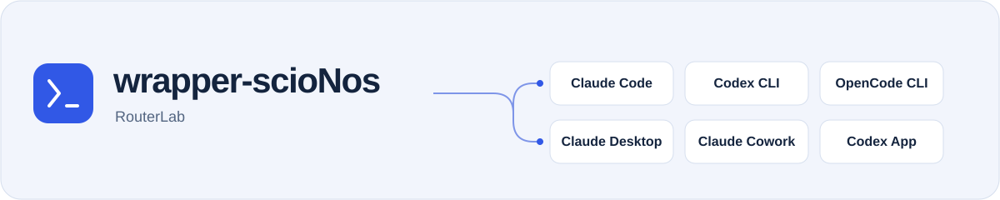
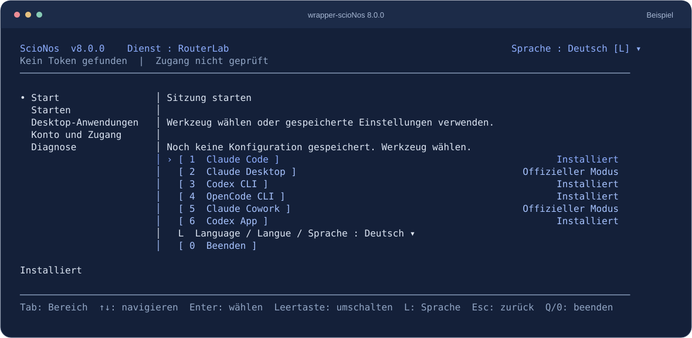

<picture>
  <source media="(max-width: 600px) and (prefers-color-scheme: dark)" srcset="./docs/assets/readme-header-compact-dark.svg">
  <source media="(max-width: 600px)" srcset="./docs/assets/readme-header-compact.svg">
  <source media="(prefers-color-scheme: dark)" srcset="./docs/assets/readme-header-dark.svg">
  
</picture>

<p align="center"><strong>Behalten Sie Ihre KI-Werkzeuge. Wählen Sie kompatible Modelle über RouterLab.</strong></p>

<p align="center">
  <a href="https://www.npmjs.com/package/wrapper-scionos"></a>
  <a href="https://github.com/ScioNos/wrapper-scionos/actions/workflows/ci.yml"></a>
  <a href="https://nodejs.org/"></a>
  <a href="./LICENSE"></a>
</p>

<p align="center"><a href="./README.md">English</a> · <a href="./README.fr.md">Français</a> · <strong>Deutsch</strong></p>

<p align="center"><a href="#erster-start">Starten</a> · <a href="#welches-werkzeug-können-sie-verwenden">Werkzeuge</a> · <a href="#häufige-fragen">Fragen</a> · <a href="./docs/reference.de.md">Referenz</a></p>

Sie nutzen bereits Claude Code, Codex oder OpenCode? wrapper-scioNos läuft auf Ihrem Computer und hilft, Ihr Werkzeug mit RouterLab zu verbinden. Wählen Sie aus den Modellen, die für Ihr Werkzeug und Ihren Zugang verfügbar sind, und arbeiten Sie in Ihrer gewohnten Anwendung weiter.

Zum Beispiel können Sie Claude Code mit einer RouterLab-Familie von Open-Source-Modellen starten oder in Codex CLI ein RouterLab-Modell auswählen. Auswahl und Funktionen hängen vom jeweiligen Werkzeug ab.



<p align="center"><sub>Die Konsole 8.0.0 mit beispielhaften Statusangaben. Verfügbare Werkzeuge und Zugänge hängen von Ihrer Konfiguration ab. <a href="./docs/assets/console-de.svg">Vergrößern</a></sub></p>

## Was macht der Wrapper?

- **Ihr Werkzeug** ist Ihre Arbeitsumgebung: Claude Code, Claude Desktop, Claude Cowork, Codex CLI, Codex App oder OpenCode.
- **RouterLab** stellt den Modellzugang bereit und erfasst Ihren API-Verbrauch.
- **wrapper-scioNos** bereitet die Verbindung vor und führt Sie in einem Terminalmenü durch die Modellauswahl.

Der Wrapper ist kostenlose Open-Source-Software unter der [MIT-Lizenz](./LICENSE). Für RouterLab-Modelle gelten Ihre Zugangsrechte und Ihr Tarif. Ein vom ursprünglichen Werkzeug benötigtes Abonnement oder Zugangsrecht bleibt davon getrennt. Sie müssen die Routing-Details nicht kennen, um zu beginnen.

## Voraussetzungen

Vor dem ersten Start benötigen Sie:

- [Node.js **24.x**](https://nodejs.org/), auf Ihrem Computer installiert.
- Das gewünschte Werkzeug, bereits in einer unterstützten Version installiert.
- Einen RouterLab-API-Schlüssel. Die [RouterLab-Schnellstartanleitung](https://routerlab.ch/de/docs/quickstart) erklärt, wie Sie ihn erhalten.

Der Wrapper läuft unter Windows, macOS und Linux. Codex App benötigt Windows oder macOS; für Claude Desktop unter Linux gelten zusätzliche Voraussetzungen. Siehe [genaue Versionen und Plattformvoraussetzungen](./docs/reference.de.md#voraussetzungen).

## Erster Start

### 1. Geführte Konsole öffnen

Öffnen Sie ein Terminal auf Ihrem Computer und führen Sie aus:

```bash
npx wrapper-scionos@8.0.0 --service routerlab --lang de
```

Bestätigen Sie die Paketinstallation, wenn npm danach fragt. Dieser Befehl startet Version **8.0.0** ohne globale Installation. Mit demselben Befehl öffnen Sie die Konsole bei der nächsten Nutzung erneut.

### 2. RouterLab-Konto verbinden

Öffnen Sie **Konto und Zugang**, wählen Sie **Token speichern oder ersetzen** und geben Sie Ihren RouterLab-API-Schlüssel in die verdeckte Eingabe ein. Gemeint ist der API-Schlüssel, nicht Ihr Kontopasswort. Ein gespeicherter Schlüssel wird bei der Vorbereitung eines Starts beim Dienst geprüft.

### 3. Werkzeug und Modelle wählen

Gehen Sie zu **Start**, wählen Sie Ihr Werkzeug und anschließend eine für Ihren Zugang angebotene Modellfamilie oder ein Modell. Mit einem Testkonto wählen Sie **Trial**, sofern diese Familie verfügbar ist. Prüfen und bestätigen Sie die Zusammenfassung.

Ihr Werkzeug startet oder seine Desktop-Verbindung wird vorbereitet. Bearbeiten Sie damit eine erste Aufgabe. Lassen Sie für Claude Desktop und Cowork den lokalen Proxy des Wrappers während der Arbeit laufen. War Codex App bereits geöffnet, starten Sie sie neu, damit die gewählte Verbindung geladen wird.

**Das erwartete Ergebnis:** Sie arbeiten in Ihrem gewohnten Werkzeug mit der gewählten RouterLab-Verbindung. Der Wrapper stellt keine neue Chatoberfläche bereit.

Navigieren Sie mit den Pfeiltasten und **Enter**, wechseln Sie mit **Tab** den Bereich und mit **L** die Sprache. In kompatiblen Terminals ist auch Mausbedienung möglich. [Vollständige Konsolenanleitung](./docs/reference.de.md#strukturierte-terminalkonsole).

## Welches Werkzeug können Sie verwenden?

| Werkzeug | Was Sie mit dem Wrapper auswählen |
| --- | --- |
| Claude Code | Eine Modellfamilie und, sofern verfügbar, ein Unteragentenmodell |
| Codex CLI | Eine Familie, dann ein kompatibles Modell im nativen `/model`-Menü |
| OpenCode CLI | Eine Familie und ein bestimmtes kompatibles Modell |
| Claude Desktop | Modellfamilien für eine verwaltete lokale Verbindung |
| Claude Cowork | Modelle über die gemeinsame Claude-Desktop-Integration |
| Codex App | Eine Familie und ein Modell mit wiederherstellbarer Verbindungskonfiguration |

Die Kompatibilität hängt von Werkzeug, Modell und Konto ab. Ein auswählbares Modell garantiert nicht dieselben Funktionen oder Ergebnisse in allen Werkzeugen. [Details je Werkzeug](./docs/reference.de.md#überblick).

## Häufige Fragen

<details>
<summary>Ist das immer günstiger?</summary>

Nein. Modell, Tokenmenge und Anzahl der Aufrufe bestimmen den Verbrauch. Vergleichen Sie die [RouterLab-Modellpreise](https://routerlab.ch/de/models) und prüfen Sie Ihren Verbrauch nach einer ersten Aufgabe.

</details>

<details>
<summary>Kann ich das Guthaben meines ChatGPT- oder Claude-Abonnements nutzen?</summary>

RouterLab-Zugang und -Verbrauch sind von Ihren Abonnements bei den ursprünglichen Werkzeuganbietern getrennt.

</details>

<details>
<summary>Ich habe bereits Zugang zum Dienst <code>llm</code>. Welchen Befehl soll ich verwenden?</summary>

Starten Sie `npx wrapper-scionos@8.0.0 --service llm --lang de` mit dem API-Schlüssel dieses Dienstes. `routerlab` und `llm` haben getrennte Schlüssel und Kataloge; wählen Sie den Dienst beim Start des Wrappers. [Dienstreferenz](./docs/reference.de.md#dienste-und-authentifizierung).

</details>

<details>
<summary>Es erscheinen keine Modelle oder der Start schlägt fehl. Was kann ich tun?</summary>

Prüfen Sie den gewählten Dienst, Ihre API-Zugangsrechte und die installierte Werkzeugversion. Öffnen Sie **Diagnose** in der Konsole. Ein nicht verfügbares Modell wird nicht stillschweigend ersetzt. Blockiert PowerShell `npx.ps1`, verwenden Sie denselben Befehl mit `npx.cmd`. [Voraussetzungen](./docs/reference.de.md#voraussetzungen) · [Befehle und Diagnose](./docs/reference.de.md#wichtige-befehle).

</details>

<details>
<summary>Wie stelle ich die ursprüngliche Verbindung einer Desktop-Anwendung wieder her?</summary>

Verwenden Sie **Desktop-Anwendungen** in der Konsole. Das Stoppen des Claude-Desktop-Proxys lässt das verwaltete Profil bestehen; die Aktion zur Wiederherstellung des offiziellen Modus entfernt es. Codex App hat eigene Wiederherstellungsfunktionen. [Claude-Desktop- und Cowork-Profile](./docs/reference.de.md#dauerhafte-profile-und-geheimnisse) · [Codex-App-Wiederherstellung](./docs/reference.de.md#codex-app-und-schutz-der-toml-konfiguration).

</details>

## Anleitungen und technische Dokumentation

- [Technische Referenz](./docs/reference.de.md): genaue Voraussetzungen, weitere Installationswege, Bedienung, Befehle, Authentifizierung, Routing und Sicherheit.
- [RouterLab-Einrichtungsanleitung](https://routerlab.ch/de/scionos-wrapper): Erklärungen und Anleitungen je Werkzeug.
- [Version 8.0.0](https://github.com/ScioNos/wrapper-scionos/releases/tag/v8.0.0) · [Changelog](./CHANGELOG.md) · [Validierungsbericht](./docs/release-8.0.0-validation.md).
- [Architektur](./docs/architecture-notes.md) · [Problem melden](https://github.com/ScioNos/wrapper-scionos/issues).

MIT © ScioNos
