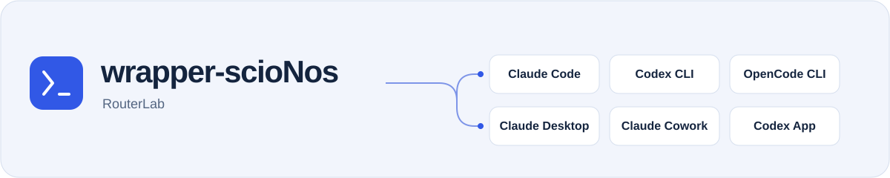
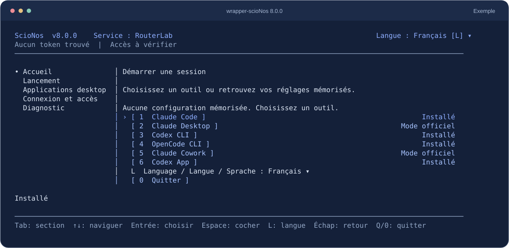

<picture>
  <source media="(max-width: 600px) and (prefers-color-scheme: dark)" srcset="./docs/assets/readme-header-compact-dark.svg">
  <source media="(max-width: 600px)" srcset="./docs/assets/readme-header-compact.svg">
  <source media="(prefers-color-scheme: dark)" srcset="./docs/assets/readme-header-dark.svg">
  
</picture>

<p align="center"><strong>Gardez vos outils IA. Choisissez des modèles compatibles via RouterLab.</strong></p>

<p align="center">
  <a href="https://www.npmjs.com/package/wrapper-scionos"></a>
  <a href="https://github.com/ScioNos/wrapper-scionos/actions/workflows/ci.yml"></a>
  <a href="https://nodejs.org/"></a>
  <a href="./LICENSE"></a>
</p>

<p align="center"><a href="./README.md">English</a> · <strong>Français</strong> · <a href="./README.de.md">Deutsch</a></p>

<p align="center"><a href="#premier-lancement">Démarrer</a> · <a href="#quel-outil-pouvez-vous-utiliser-">Outils</a> · <a href="#questions-fréquentes">Questions</a> · <a href="./docs/reference.fr.md">Référence</a></p>

Vous utilisez déjà Claude Code, Codex ou OpenCode ? wrapper-scioNos fonctionne sur votre ordinateur et vous aide à connecter votre outil à RouterLab. Choisissez parmi les modèles disponibles pour votre outil et votre compte, puis travaillez dans votre application habituelle.

Par exemple, vous pouvez lancer Claude Code avec une famille de modèles open source RouterLab, ou choisir un modèle RouterLab dans Codex CLI. Les choix et les fonctionnalités disponibles dépendent de chaque outil.



<p align="center"><sub>Console 8.0.0, générée avec des statuts d’illustration. Les outils et accès disponibles dépendent de votre configuration. <a href="./docs/assets/console-fr.svg">Agrandir</a></sub></p>

## À quoi sert le wrapper ?

- **Votre outil** est l’endroit où vous travaillez : Claude Code, Claude Desktop, Claude Cowork, Codex CLI, Codex App ou OpenCode.
- **RouterLab** fournit l’accès aux modèles et comptabilise votre consommation API.
- **wrapper-scioNos** prépare la connexion et vous guide dans le choix des modèles depuis un menu dans le terminal.

Le wrapper est un logiciel gratuit et open source, sous [licence MIT](./LICENSE). L’utilisation des modèles RouterLab suit vos droits d’accès et votre offre tarifaire. Tout abonnement ou accès requis par l’outil d’origine reste distinct. Vous pouvez commencer sans comprendre les détails du routage.

## Prérequis

Avant le premier lancement, il vous faut :

- [Node.js **24.x**](https://nodejs.org/) installé sur votre ordinateur.
- L’outil que vous souhaitez utiliser, déjà installé dans une version prise en charge.
- Une clé API RouterLab. Le [guide de démarrage RouterLab](https://routerlab.ch/fr/docs/quickstart) explique comment l’obtenir.

Le wrapper fonctionne sous Windows, macOS et Linux. Codex App nécessite Windows ou macOS ; Claude Desktop sous Linux a des prérequis particuliers. Consultez les [versions exactes et les prérequis par plateforme](./docs/reference.fr.md#prérequis).

## Premier lancement

### 1. Ouvrez la console guidée

Ouvrez un terminal sur votre ordinateur et lancez :

```bash
npx wrapper-scionos@8.0.0 --service routerlab --lang fr
```

Acceptez l’installation du paquet si npm vous la propose. Cette commande lance la version **8.0.0**, sans installation globale. Relancez la même commande pour retrouver la console lors de vos prochaines utilisations.

### 2. Connectez votre compte RouterLab

Ouvrez **Connexion et accès**, choisissez **Enregistrer ou remplacer le token** et saisissez votre clé API RouterLab dans le champ masqué. Il s’agit de la clé API, pas du mot de passe de votre compte. Une clé enregistrée est vérifiée auprès du service lors de la préparation d’un lancement.

### 3. Choisissez votre outil et vos modèles

Revenez à **Accueil**, sélectionnez votre outil, puis la famille ou le modèle proposé pour votre accès. Avec un compte d’essai, choisissez **Trial** lorsque cette famille est disponible. Vérifiez le récapitulatif et confirmez.

Votre outil démarre, ou sa connexion desktop est préparée. Utilisez-le pour une première tâche. Pour Claude Desktop et Cowork, gardez le proxy local du wrapper actif pendant votre travail. Si Codex App était déjà ouverte, redémarrez-la pour charger la connexion choisie.

**Le résultat attendu :** vous travaillez dans votre outil habituel avec la connexion RouterLab sélectionnée. Le wrapper ne fournit pas une nouvelle interface de conversation.

Utilisez les flèches et **Entrée** pour naviguer, **Tab** pour changer de zone et **L** pour changer de langue. La souris fonctionne dans les terminaux compatibles. [Guide complet de la console](./docs/reference.fr.md#console-structurée).

## Quel outil pouvez-vous utiliser ?

| Outil | Ce que vous choisissez avec le wrapper |
| --- | --- |
| Claude Code | Une famille de modèles et, selon les options disponibles, un modèle de sous-agent |
| Codex CLI | Une famille, puis un modèle compatible dans le sélecteur natif `/model` |
| OpenCode CLI | Une famille et un modèle compatible précis |
| Claude Desktop | Des familles de modèles pour une connexion locale gérée |
| Claude Cowork | Des modèles via l’intégration partagée avec Claude Desktop |
| Codex App | Une famille et un modèle, avec une configuration de connexion restaurable |

La compatibilité dépend de l’outil, du modèle et du compte. Un modèle sélectionnable ne garantit pas les mêmes fonctionnalités ni les mêmes résultats dans tous les outils. [Fonctionnement détaillé par outil](./docs/reference.fr.md#en-bref).

## Questions fréquentes

<details>
<summary>Est-ce toujours moins cher ?</summary>

Non. Le modèle choisi, le volume de tokens et le nombre d’échanges déterminent votre consommation. Comparez les [tarifs des modèles RouterLab](https://routerlab.ch/fr/models) et consultez votre usage après une première tâche.

</details>

<details>
<summary>Puis-je utiliser les crédits de mon abonnement ChatGPT ou Claude ?</summary>

L’accès et la consommation RouterLab sont distincts de vos abonnements auprès des fournisseurs des outils d’origine.

</details>

<details>
<summary>J’ai déjà un accès au service <code>llm</code>. Quelle commande utiliser ?</summary>

Lancez `npx wrapper-scionos@8.0.0 --service llm --lang fr` avec la clé API de ce service. `routerlab` et `llm` ont des clés et des catalogues distincts ; choisissez votre service au démarrage du wrapper. [Référence des services](./docs/reference.fr.md#services-et-authentification).

</details>

<details>
<summary>Aucun modèle n’apparaît ou le lancement échoue : que faire ?</summary>

Vérifiez le service choisi, vos droits d’accès API et la version de l’outil installé. Ouvrez **Diagnostic** dans la console. Un modèle indisponible n’est pas remplacé silencieusement. Si PowerShell bloque `npx.ps1`, utilisez la même commande avec `npx.cmd`. [Prérequis](./docs/reference.fr.md#prérequis) · [Commandes et diagnostic](./docs/reference.fr.md#commandes-principales).

</details>

<details>
<summary>Comment retrouver la connexion d’origine d’une application desktop ?</summary>

Utilisez l’écran **Applications desktop** de la console. Arrêter le proxy Claude Desktop laisse son profil géré en place ; l’action de restauration du mode officiel permet de le retirer. Codex App possède ses propres commandes de restauration. [Profils Claude Desktop et Cowork](./docs/reference.fr.md#profils-persistants-et-secrets) · [Restauration Codex App](./docs/reference.fr.md#codex-app-et-protection-du-toml).

</details>

## Guides et documentation technique

- [Référence technique](./docs/reference.fr.md) : prérequis exacts, autres installations, navigation, commandes, authentification, routage et sécurité.
- [Guide de configuration RouterLab](https://routerlab.ch/fr/scionos-wrapper) : explications et guides par outil.
- [Version 8.0.0](https://github.com/ScioNos/wrapper-scionos/releases/tag/v8.0.0) · [Journal des changements](./CHANGELOG.md) · [Bilan de validation](./docs/release-8.0.0-validation.md).
- [Architecture](./docs/architecture-notes.md) · [Signaler un problème](https://github.com/ScioNos/wrapper-scionos/issues).

MIT © ScioNos
