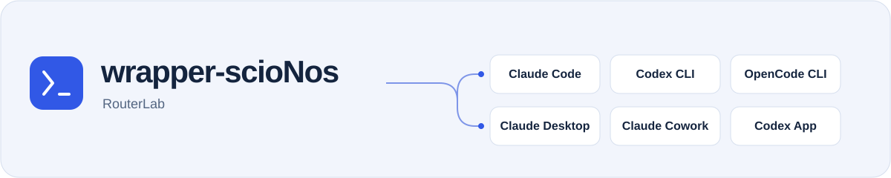
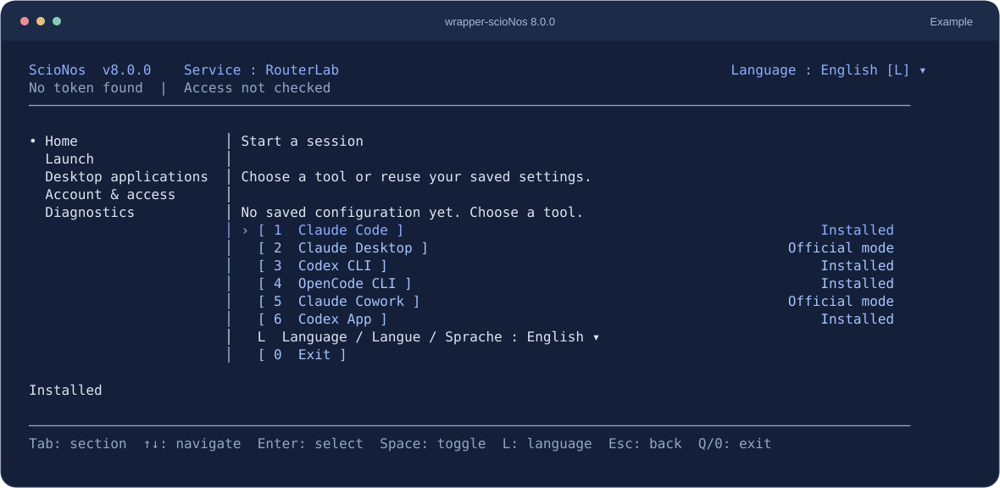

<picture>
  <source media="(max-width: 600px) and (prefers-color-scheme: dark)" srcset="./docs/assets/readme-header-compact-dark.svg">
  <source media="(max-width: 600px)" srcset="./docs/assets/readme-header-compact.svg">
  <source media="(prefers-color-scheme: dark)" srcset="./docs/assets/readme-header-dark.svg">
  
</picture>

<p align="center"><strong>Keep your AI tools. Choose compatible models through RouterLab.</strong></p>

<p align="center">
  <a href="https://www.npmjs.com/package/wrapper-scionos"></a>
  <a href="https://github.com/ScioNos/wrapper-scionos/actions/workflows/ci.yml"></a>
  <a href="https://nodejs.org/"></a>
  <a href="./LICENSE"></a>
</p>

<p align="center"><strong>English</strong> · <a href="./README.fr.md">Français</a> · <a href="./README.de.md">Deutsch</a></p>

<p align="center"><a href="#first-launch">Get started</a> · <a href="#which-tool-can-i-use">Tools</a> · <a href="#common-questions">Questions</a> · <a href="./docs/reference.md">Reference</a></p>

Already using Claude Code, Codex or OpenCode? wrapper-scioNos runs on your computer and helps connect your tool to RouterLab. Choose from the models available for your tool and account, then work in your usual application.

For example, you can launch Claude Code with a RouterLab open-source model family, or choose a RouterLab model in Codex CLI. The available choices and features depend on each tool.



<p align="center"><sub>The 8.0.0 console, rendered with example statuses. Your available tools and access may differ. <a href="./docs/assets/console-en.svg">View full size</a></sub></p>

## What does the wrapper do?

- **Your tool** is where you work: Claude Code, Claude Desktop, Claude Cowork, Codex CLI, Codex App or OpenCode.
- **RouterLab** provides access to the models and tracks your API consumption.
- **wrapper-scioNos** prepares the connection and guides your model selection in a terminal menu.

The wrapper is free, open-source software under the [MIT licence](./LICENSE). RouterLab model usage follows your access rights and pricing plan. Any subscription or access required by the original tool remains separate. You do not need to understand the routing internals to get started.

## Requirements

Before your first launch, you need:

- [Node.js **24.x**](https://nodejs.org/) installed on your computer.
- The tool you want to use, already installed in a supported version.
- A RouterLab API key. The [RouterLab quickstart](https://routerlab.ch/en/docs/quickstart) explains how to get one.

The wrapper runs on Windows, macOS and Linux. Codex App requires Windows or macOS; Claude Desktop on Linux has additional requirements. See the [exact supported versions and platform requirements](./docs/reference.md#requirements).

## First launch

### 1. Open the guided console

Open a terminal on your computer and run:

```bash
npx wrapper-scionos@8.0.0 --service routerlab --lang en
```

Accept npm's package installation prompt if it appears. This runs version **8.0.0** without a global installation. Run the same command again when you want to reopen the console.

### 2. Connect your RouterLab account

Open **Account & access**, choose **Store or replace token** and enter your RouterLab API key in the masked prompt. Your account password is not the API key. A stored key is checked against the service when you prepare a launch.

### 3. Choose your tool and models

Return to **Home**, select your tool, then choose the model family or model offered for your access. With a trial account, choose **Trial** where available. Review the summary and confirm.

Your tool then starts, or its Desktop connection is prepared. Use it for a first task. For Claude Desktop and Cowork, keep the wrapper's local proxy running while you work. If Codex App was already open, restart it to load the selected connection.

**Expected result:** you work in your usual tool using the selected RouterLab connection. The wrapper does not provide a new chat interface.

Use the arrow keys and **Enter** to navigate, **Tab** to switch areas and **L** to change language. Mouse navigation is available in compatible terminals. [Full console guide](./docs/reference.md#structured-terminal-console).

## Which tool can I use?

| Tool | What you choose with the wrapper |
| --- | --- |
| Claude Code | A model family and, where available, a sub-agent model |
| Codex CLI | A family, then a compatible model through the native `/model` selector |
| OpenCode CLI | A family and an exact compatible model |
| Claude Desktop | Model families for a managed local connection |
| Claude Cowork | Models through the shared Claude Desktop integration |
| Codex App | A family and model with a restorable connection configuration |

Compatibility varies by tool, model and account. A selectable model does not guarantee identical features or results across tools. [Detailed behaviour by tool](./docs/reference.md#at-a-glance).

## Common questions

<details>
<summary>Will this always cost less?</summary>

No. The chosen model, token volume and number of exchanges determine consumption. Compare the [RouterLab model prices](https://routerlab.ch/en/models) and check your usage after a first task.

</details>

<details>
<summary>Can I use my existing ChatGPT or Claude subscription credits?</summary>

RouterLab access and consumption are separate from your subscriptions with the original tool providers.

</details>

<details>
<summary>I already have access to the <code>llm</code> service. What should I run?</summary>

Use `npx wrapper-scionos@8.0.0 --service llm --lang en` and that service's API key. `routerlab` and `llm` have separate keys and catalogues; select your service when starting the wrapper. [Service reference](./docs/reference.md#services-and-authentication).

</details>

<details>
<summary>What if no models appear or a launch fails?</summary>

Check the selected service, your API access and the installed tool version. Use **Diagnostics** in the console. An unavailable model is not silently replaced. If PowerShell blocks `npx.ps1`, run the same command with `npx.cmd`. [Requirements](./docs/reference.md#requirements) · [Commands and diagnostics](./docs/reference.md#main-commands).

</details>

<details>
<summary>How do I return a Desktop application to its original connection?</summary>

Use the console's **Desktop applications** screen. Stopping the Claude Desktop proxy leaves its managed profile applied; use the official-mode restoration action to remove it. Codex App has its own restoration controls. [Claude Desktop and Cowork profiles](./docs/reference.md#persistent-profiles-and-secrets) · [Codex App restoration](./docs/reference.md#codex-app-and-toml-preservation).

</details>

## Guides and technical documentation

- [Technical reference](./docs/reference.md): exact requirements, alternative installations, console controls, commands, authentication, routing and security.
- [RouterLab setup guide](https://routerlab.ch/en/scionos-wrapper): explanations and tool guides.
- [Version 8.0.0 release](https://github.com/ScioNos/wrapper-scionos/releases/tag/v8.0.0) · [Changelog](./CHANGELOG.md) · [Release validation](./docs/release-8.0.0-validation.md).
- [Architecture](./docs/architecture-notes.md) · [Report an issue](https://github.com/ScioNos/wrapper-scionos/issues).

MIT © ScioNos
